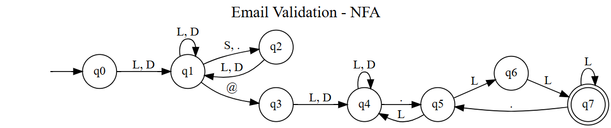

# FLA Task 2 – Finite Automata-Based Validation System

This project implements a Python-based validation system using **Deterministic Finite Automata (DFA)** to validate different real-world input formats.

The project demonstrates how finite automata can accept or reject input strings based on predefined rules and state transitions.

## Case Studies

### 1. ATM PIN Verification

Validates ATM PINs based on the required length and numeric format. The DFA accepts valid four-digit PINs and rejects invalid inputs.

**DFA State Diagram:**


### 2. Password Validation

Validates passwords based on predefined password requirements. The DFA checks whether the entered password satisfies the required validation rules.

**DFA State Diagram:**


### 3. Email Format Validation

Validates email addresses based on the defined email format. The DFA checks the input structure and determines whether the email address is valid or invalid.

**DFA State Diagram:**



## Technologies Used

- Python
- Jupyter Notebook
- Finite Automata
- Deterministic Finite Automata (DFA)

## Project Structure

```text
FLA-Task-2/
│
├── FLA_Task_2.ipynb
├── ATM_Pin .png
├── Password_Validation .png
├── Email_Validation.png
└── README.md
```

## Testing

The validation systems are tested using both valid and invalid input strings to verify the acceptance and rejection behavior of each DFA.

Automated testing is also performed to check whether the implemented validation logic produces the expected results.

## Conclusion

This project demonstrates the practical application of Finite Automata in real-world validation systems. It shows how DFA can recognize valid input patterns and reject invalid ones through state transitions.
